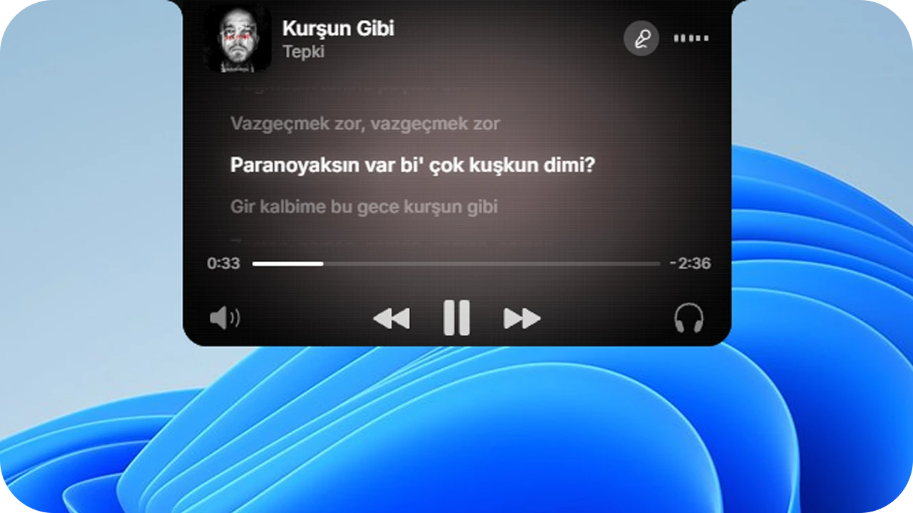

<div align="center">


<br />

<picture>
  <source media="(prefers-color-scheme: dark)" srcset="docs/wordmark-dark.png" />
  
</picture>

<p><strong>A notch and a dock for Windows — physics-animated, reactive, and built to replace your taskbar.</strong><br /><sub>Productivity, media, hardware control, and AI agent awareness in one native layer for Windows 11.</sub></p>

[](https://github.com/kagangungor/Fern/releases/latest)
[](https://github.com/kagangungor/Fern/releases)
[](LICENSE)
[](https://www.microsoft.com/windows)

[**Download**](https://github.com/kagangungor/Fern/releases/latest) &nbsp;·&nbsp; [Features](#features) &nbsp;·&nbsp; [Install](#install) &nbsp;·&nbsp; [Usage](#usage) &nbsp;·&nbsp; [Settings](SETTINGS.md) &nbsp;·&nbsp; [Sponsor](https://buymeacoffee.com/kagangungor) &nbsp;·&nbsp; [Report a bug](https://github.com/kagangungor/Fern/issues/new/choose)

<br />


</div>

<br />

## Features

| Area | What Fern gives you |
| --- | --- |
| **Notch & Media** | Spring-animated island with **Live Synchronized Lyrics** (click any line to seek), album-art theming, multi-session switching, a drag-to-arrange **Control Center**, Calendar (`Day / Week / Month / Agenda` + read-only `.ics` & CalDAV sync), Timer, Stopwatch, Dual Clock, and a persistent File Shelf. |
| **Hardware & Audio** | Live **split battery levels** (left bud, right bud, case) for AirPods, Beats, Google Fast Pair earbuds, and Samsung Galaxy Buds, plus USB & 3.5mm jack alerts with custom vector art. Scroll any running **Dock icon** to adjust that app's volume in real time with a floating mini-HUD. |
| **Privacy & Meetings** | **Privacy Aura** glows around the notch whenever your camera or microphone is active, paired with a system-wide **Mic Mute hotkey** (`Ctrl+F1` by default) that works across Zoom, Teams, Meet, and Discord. |
| **AI Agent Companion** | **Fernie** reacts to background AI workflows (`working`, `needs_input`, `done`, `error`) with audio cues, automatic **Claude Code** hooks, and a local authenticated HTTP API where you can approve or deny prompts right from the notch. |
| **Taskbar Replacement Dock** | Mirrors your pinned apps and order with real icons, live **DWM window previews**, attention badges, drag-and-drop hover focus, `Win+1..9` switching, native Windows tray flyout, `End Task`, Show Desktop corner, drives/Recycle Bin, and launcher integration (Windows Search, PowerToys Run, Raycast, Flow Launcher, Everything, Listary). |
| **Glass, Themes & Performance** | **Solid**, **Frosted Glass**, **Liquid Glass** (with blurred wallpaper & cursor Edge Shine), and **Material You** styles, plus optional **Windows Accent Sync**. On-demand Settings/Calendar windows, **Memory Saver**, multi-monitor rules, English & Turkish UI, and live-reloaded `settings.json`. |

<div align="center">
<table>
  <tr>
    <td align="center"></td>
    <td align="center"></td>
  </tr>
  <tr>
    <td align="center"><sub>The notch (with active mic indicator)</sub></td>
    <td align="center"><sub>The dock</sub></td>
  </tr>
</table>
</div>

## Install

Download from the [latest release](https://github.com/kagangungor/Fern/releases/latest):

- **Installer (`Fern-Setup-<version>.exe`)** — Choose **Just me** or **All users** (asks for administrator permission once). Launches with a short splash, then starts the notch and dock together.
- **Portable (`fern-<version>-portable-windows-x64.zip`)** — Extract and run `fern.exe` directly without installing.

Fern updates itself: a green dot on the notch signals a ready update, and **Auto Update** in **Settings › About** installs it for you. Enable **Get pre-releases** there for early builds. Uninstalling from **Windows Settings › Apps** or **Settings › About** automatically restores your Windows taskbar.

<details>
<summary>Download safety</summary>

<br />

Only download Fern binaries from the official [releases page](https://github.com/kagangungor/Fern/releases) of this repository. You can inspect the local file hash at any time with:

```powershell
Get-FileHash .\Fern-Setup-<version>.exe -Algorithm SHA256
```

</details>

## Usage

### Notch panels

Scroll or swipe on the notch to cycle through panels (customizable order in **Settings › Notch**):

| Panel | What it does |
| --- | --- |
| **Music** | Album art, dynamic cover tinting, playback controls, visualizer, multi-app audio switcher, and **Live Synchronized Lyrics** with click-to-seek. |
| **Control Center** | Wi-Fi, Bluetooth, Do Not Disturb, Battery Saver, volume (with output switcher & per-app mixer), and brightness. Drag tiles, buttons, and sliders into your own layout. |
| **Status** | Configurable left/right widgets: weather, battery (auto-hidden on desktops), CPU, RAM, disk, and network speed/status. |
| **Connected Devices** | Live battery readouts and dynamic SVG cards for Bluetooth earbuds (individual left/right/case levels), headsets, and USB peripherals. |
| **Calendar** | Day, week, month, and agenda views synced from `.ics` / `webcal://` links or CalDAV (credentials stored in Windows Credential Manager), plus timer, stopwatch, and Pomodoro. |
| **Shelf** | Drop files or text onto the notch to keep them handy and drag them into any app later. |
| **Agent Companion** | Fernie mascot status card with tool details, click-to-focus window jumping, and **Allow / Deny** buttons for interactive prompts. |

<div align="center">
  
  <br />
  <sub>Live Synchronized Lyrics — click any line to seek</sub>
</div>

### Visibility & overlays

The notch and the dock each configure their own visibility mode — and when **Show On** is set to **All Monitors**, you can assign **Per-Monitor Behavior** independently:

| Mode | Behavior |
| --- | --- |
| **Fixed** | Always visible. The dock reserves screen space like a standard taskbar (and supports **Adaptive Mode** to stretch full-width when a window is maximized). |
| **Smart** | Automatically hides when overlapped by another window or fullscreen app and reveals on hover. |
| **Peek** | Stays hidden until the cursor reaches the screen edge or a media/notification event arrives. |

In **Smart** and **Peek**, both stay hidden and click-through over fullscreen games and apps. Fern also includes edge-triggered **Volume** and **Brightness** HUD overlays (with DDC/CI support for external monitors).

### Shortcuts & quick actions

| Action | Trigger |
| --- | --- |
| **Per-app volume** | Scroll mouse wheel over any running Dock icon (`Middle-click` to mute) |
| **Toggle microphone** | `Ctrl+F1` (customizable under **Settings › Notch › Meeting & Privacy**) |
| **Toggle notch** | Customizable global shortcut under **Settings › Notch › Keyboard Shortcuts** |
| **Switch or launch pinned apps** | `Win+1` .. `Win+9` |
| **Drag file to open window** | Drag any file over a Dock icon and hold briefly (`450 ms`) to bring it to front |

<details>
<summary><b>For developers: AI Agent API & Claude Code integration</b></summary>

<br />

When **Claude Code & AI agents** is enabled in **Settings › Notch**, Fern automatically configures Claude Code hooks and starts an authenticated loopback HTTP server described in `%APPDATA%\com.kagangungor.fern\agent.json` (`port` and `token`).

- `POST /activity` — Push states (`working`, `tool`, `needs_input`, `done`, `error`, `clear`) with optional `name`, `project`, `detail`, and `window` HWND.
- `POST /ask` — Display an interactive **Allow / Deny** prompt inside the notch and wait for the user's decision.

</details>

## Troubleshooting

<details>
<summary><b>The dock shows over my game</b></summary>

<br />

Fern hides the dock and notch over fullscreen windows in **Smart** and **Peek** modes. **Fixed** mode stays visible by design. If something still appears over a game, open an issue with the game name and display mode (fullscreen, borderless, or windowed).

</details>

<details>
<summary><b>The Windows taskbar did not come back</b></summary>

<br />

Start Fern again — it restores the taskbar on launch even after a crash. Uninstalling from **Windows Settings › Apps** or **Settings › About** also brings it back.

</details>

<details>
<summary><b>Memory usage on multi-monitor setups</b></summary>

<br />

Fern loads secondary windows (Settings, Calendar) on demand, and you can enable **Memory Saver** under **Settings › General** to trim working sets and slow background checks while idle or locked. When **Show On** is set to **All Monitors**, each extra display runs its own notch and dock WebViews — switching to **Primary Monitor** reduces memory usage further.

</details>

<details>
<summary><b>Brightness does not change on my external monitor</b></summary>

<br />

External monitors are controlled over DDC/CI. Enable DDC/CI in your monitor's on-screen menu and connect it directly if you use a USB-C hub or dock, as some adapters block DDC/CI commands.

</details>

<details>
<summary><b>Something else is broken</b></summary>

<br />

Open **Settings › Diagnostics › Copy Diagnostics** and paste the output into a [bug report](https://github.com/kagangungor/Fern/issues/new/choose). It includes your app version, monitor layout, and recent logs.

</details>

## Build from source

You need [Rust](https://rustup.rs/) and [Bun](https://bun.sh/) on Windows.

```bash
git clone https://github.com/kagangungor/Fern.git
cd Fern
bun install
bun run tauri dev
```

`bun run tauri build` creates a release build. Before opening a pull request, read [CONTRIBUTING.md](CONTRIBUTING.md).

## Roadmap

### Shipped highlights
- [x] **Live Synchronized Lyrics (Karaoke Mode)** — Real-time synced lyrics with click-to-seek inside the music notch
- [x] **Per-App Audio Scroll Mixer** — Fluid per-application volume control directly from Dock icons
- [x] **Universal Meeting & Privacy HUD** — Camera/mic Privacy Aura and system-wide Mic Mute hotkey
- [x] **Connected Hardware & Fernie Agent API** — Split TWS earbud battery levels, USB/jack popups, and Claude Code notch integration

### Upcoming milestones
- [ ] **Developer & Terminal Ambient HUD** — Visual notch progress line for long-running CLI tasks (`cargo build`, `npm install`, `docker`, test suites) and active Git branch / dirty-file context when an IDE or terminal is focused
- [ ] **Pro Clipboard & Smart Inspector** — Fast island clipboard history with live color token previews (`#hex`, `rgb`, `hsl`), Tailwind/CSS conversion, and quick JSON/Base64/regex actions

See the [open issues](https://github.com/kagangungor/Fern/issues) for feature requests and known bugs.

## Built with

[](https://tauri.app/)
[](https://www.rust-lang.org/)
[](https://react.dev/)
[](https://www.typescriptlang.org/)
[](https://vitejs.dev/)

## Support

Fern is free and open source. If it makes your desktop nicer, you can support its development:

[](https://buymeacoffee.com/kagangungor)

## License

Fern is open source under the [GPLv3](LICENSE).

## Credits

Fern is a fork of [Nectar](https://github.com/kua8/Nectar) by kua8, which began as a fork of [Bloom](https://github.com/SehajveerSingh2005/bloom) by Sehajveer Singh. Fern split from Nectar in 2026, has been modified extensively since, and is distributed under the GPLv3.
