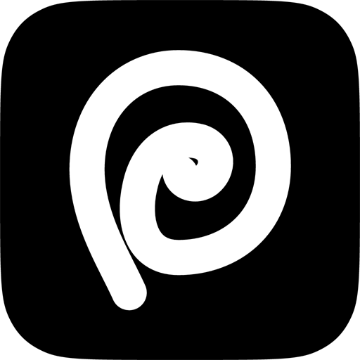
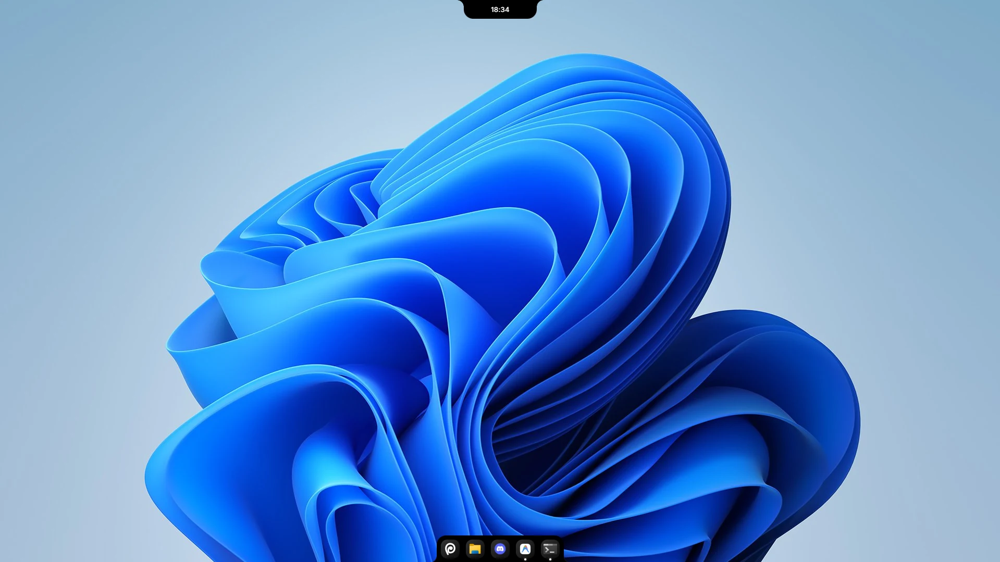

<div align="center">



<br />

<picture>
  <source media="(prefers-color-scheme: dark)" srcset="docs/wordmark-dark.png" />
  
</picture>

<p><strong>A notch and a dock for Windows.<br />Physics-animated, reactive, and built to replace your taskbar.</strong></p>

[](https://github.com/kagangungor/Fern/releases/latest)
[](LICENSE)
[](https://www.microsoft.com/windows)

[**Download**](https://github.com/kagangungor/Fern/releases/latest) &nbsp;·&nbsp; [Features](#features) &nbsp;·&nbsp; [Install](#install) &nbsp;·&nbsp; [Settings](SETTINGS.md) &nbsp;·&nbsp; [Report a bug](https://github.com/kagangungor/Fern/issues/new/choose)

<br />



</div>

<br />

## Features

| What you get | How |
| --- | --- |
| **A notch that does things** | Music, a Control Center you arrange yourself, status, calendar, connected devices, and a file shelf in one spring-animated island. |
| **Hardware & Connected Devices** | Real-time battery levels for Bluetooth earbuds (AirPods, Galaxy Buds), headsets, and USB peripherals with custom dynamic vector art. |
| **Fernie Mascot & Agent Status** | Interactive desktop companion with reactive states (idle, working, music, sleeping) and audio cues for local AI agent workflows. |
| **A dock that replaces your taskbar** | Mirrors your real taskbar, same pinned apps and order, window previews, attention badges, with real icons and names. |
| **Native where it counts** | The tray opens the real Windows flyout, Win+1..9 switches apps, and Quit ends an app like Task Manager's End task. |
| **Out of your way** | Fixed, Smart or Peek modes, with intelligent click-through and zero interference over fullscreen games. |
| **Made for your setup** | Every monitor, one monitor, or a specific one. English and Turkish. Every option lives in a plain `settings.json`. |
| **Light on the system** | Secondary windows (Settings, Calendar) load on demand, background memory saver suspends idle WebViews, and sensors pause when not needed. |

<div align="center">
<table>
  <tr>
    <td align="center"></td>
    <td align="center"></td>
  </tr>
  <tr>
    <td align="center"><sub>The notch</sub></td>
    <td align="center"><sub>The dock</sub></td>
  </tr>
</table>
</div>

## Install

1. Download the installer from the [latest release](https://github.com/kagangungor/Fern/releases/latest).
2. Choose **Just me** or **All users**. An all-users install asks for administrator permission once.
3. Fern starts with a short splash, then the notch and dock appear together.

Fern updates itself: a green dot on the notch means an update is ready, and **Auto Update** in **Settings › About** installs it for you. Turn on **Get pre-releases** there to receive early builds before the weekly release. **Uninstall** from Windows Settings › Apps or from **Settings › About**, either puts your taskbar back.

<details>
<summary>Verify your download</summary>

<br />

Only download Fern from the [releases page](https://github.com/kagangungor/Fern/releases) of this repository. Each release has a `SHA256SUMS.txt`. Compare the output of this command with the matching line:

```powershell
Get-FileHash .\Fern-Setup-<version>.exe -Algorithm SHA256
```

</details>

## Usage

**Notch panels.** Scroll or swipe on the notch to change panel.

| Panel | What it does |
| --- | --- |
| **Music** | Album art, track info, playback controls, a visualizer, and a switch between several playing apps. |
| **Control Center** | Wi-Fi, Bluetooth, Do Not Disturb, volume and brightness. Drag tiles, buttons and sliders into your own layout. |
| **Status** | Battery (hidden on desktops without one) and weather, in a layout you choose. |
| **Connected Devices** | Live battery indicators and hardware detection for Bluetooth earbuds (AirPods, Galaxy Buds case & buds), headsets, and USB devices. |
| **Calendar** | Day, week, month and agenda views, a timer, a stopwatch and Pomodoro. |
| **Shelf** | Drop files or text on the notch and drag them out later. |
| **Agent Companion** | Fernie mascot animations reflecting background AI agent status (idle, working, needs input, done, error) with subtle audio cues. |

**Visibility modes.** The notch and the dock each have their own.

| Mode | Behavior |
| --- | --- |
| **Fixed** | Always visible. The dock reserves screen space like a normal taskbar. |
| **Smart** | Hides when another window overlaps it and reveals on hover. |
| **Peek** | Hidden until the cursor reaches the screen edge, or a media event arrives. |

In Smart and Peek both stay hidden, and click-through, while a fullscreen app is in front.

**Multiple monitors.** Under **Show On**, pick **Primary Monitor** (the default), **All Monitors** or a **Specific Monitor** for the dock and the notch separately. Each extra monitor gets its own windows, so **All Monitors** uses more memory than a single display.

## Troubleshooting

<details>
<summary><b>The dock shows over my game</b></summary>

<br />

Fern hides the dock and notch over a fullscreen window that covers the whole monitor, in Smart and Peek. Fixed mode stays visible by design. If something still appears, open an issue with the game and its display mode (fullscreen, borderless or windowed).

</details>

<details>
<summary><b>The Windows taskbar did not come back</b></summary>

<br />

Start Fern again, it restores the taskbar on launch even after a crash. Uninstalling from Windows Settings › Apps or from **Settings › About** brings it back too.

</details>

<details>
<summary><b>Fern uses a lot of memory</b></summary>

<br />

With on-demand window loading and the background memory saver, Fern keeps memory usage minimal during normal use. However, when **Show On** is set to **All Monitors**, each extra monitor runs its own notch and dock windows. Set **Show On** to **Primary Monitor** to reduce memory footprint even further.

</details>

<details>
<summary><b>Brightness does not change on my external monitor</b></summary>

<br />

External monitors are controlled over DDC/CI. Turn DDC/CI on in the monitor's own menu, and connect it directly if you use a dock or adapter, since some do not pass it on.

</details>

<details>
<summary><b>Something else is broken</b></summary>

<br />

Open **Settings › About › Copy Diagnostics** and paste the result into a [bug report](https://github.com/kagangungor/Fern/issues/new/choose). It includes your versions, monitors and recent log.

</details>

## Build from source

You need [Rust](https://rustup.rs/) and [Bun](https://bun.sh/) on Windows.

```bash
git clone https://github.com/kagangungor/Fern.git
cd Fern
bun install
bun run tauri dev
```

`bun run tauri build` makes a release build. Before a pull request, read [CONTRIBUTING.md](CONTRIBUTING.md).

## Roadmap

These are ideas under consideration, not promises.

- [x] Lower memory use, with Settings and secondary windows loaded on demand
- [x] Connected devices status & battery levels (Bluetooth, Buds, USB)
- [x] Fernie companion mascot with agent integration & audio alerts
- [ ] Background tray programs (antivirus, VPN) in the notch
- [ ] Code signing for the installer

See the [open issues](https://github.com/kagangungor/Fern/issues) for requests and known bugs.

## Built with

[](https://tauri.app/)
[](https://www.rust-lang.org/)
[](https://react.dev/)
[](https://www.typescriptlang.org/)
[](https://vitejs.dev/)

## License

Fern is open source under the [GPLv3](LICENSE).

## Credits

Fern is a fork of [Nectar](https://github.com/kua8/Nectar) by kua8, which began as a fork of [Bloom](https://github.com/SehajveerSingh2005/bloom) by Sehajveer Singh. Fern split from Nectar in 2026, has been modified since, and is distributed under the GPLv3.
